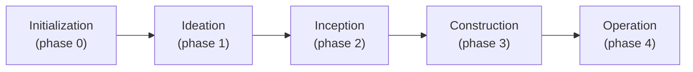

# AICC AI-DLC

AICC AI-DLC provides Huron engineers with a standardized, AI-powered software development lifecycle built on the official [AWS AI-DLC](https://github.com/awslabs/aidlc-workflows) framework. Engineers can plan, design, build, test, and deliver applications using their preferred supported AI coding tool, while HCG-AICC GitHub provides centralized source control.

AICC uses the **official AWS AI-DLC framework** — it does not create or maintain its own AI-DLC engine. The runtime, agents, harness integrations, and approval mechanisms are AWS's, used as provided.

## How It Works

The engineer journey, end to end:

1. **Create Your Workspace** — Set up a development folder on your computer.
2. **Install AWS AI-DLC** — Install the framework once per computer.
3. **Connect to Huron GitHub** — Create an application repository under HCG-AICC and clone it into your workspace.
4. **Configure AI-DLC** — Select your preferred AI coding harness.
5. **Verify Your Setup** — Confirm AI-DLC is ready.
6. **Build Your Application** — Use the official AWS AI-DLC lifecycle to plan, design, implement, and test.
7. **Save to GitHub** — Commit and push your application code to HCG-AICC.

> Engineers install AWS AI-DLC only once per computer. For each new application, they create or clone a GitHub repository and configure AI-DLC within that project.

## Getting Started

There are two ways to start an application. Pick one, then follow the setup procedure for your operating system — the seven steps map to the overview above.

### Option 1 — GitHub Template (Recommended — Coming Soon)

Huron is developing an approved AICC AI-DLC application template. Once available, you will create a new application repository with GitHub's native **Use this template** feature, which will standardize starter documentation, engineering guidance, and application repository structure.

> ⚠️ **Coming Soon.** The template does not exist yet. Until it is published, use Manual Setup below. (This README will be updated with the template link when it is available.)

### Option 2 — Manual Setup (Available Now)

Create and configure an application using the tested manual process. This is the currently available approach — follow the procedure for your operating system:

- [macOS — Terminal](#macos--terminal)
- [Windows — PowerShell](#windows--powershell)

### macOS — Terminal

Use **Terminal** (zsh) for every command in this section. The same seven steps apply.

**Before You Begin**

The commands below use `my-app` as an example application name and `HCG-AICC` as the GitHub organization. Replace `my-app` with your actual application name and use that same name consistently in every command. Replace `HCG-AICC` with your authorized GitHub organization or username if different.

For example:

- Project name: `contract-analyzer`
- GitHub organization: `HCG-AICC`
- GitHub repository: `HCG-AICC/contract-analyzer`
- Local folder: `~/Desktop/contract-analyzer`

Using these values consistently prevents directory and repository errors.

#### Step 1 — Create Your Workspace

Create your application folder directly on your Desktop and enter it:

```bash
mkdir -p "$HOME/Desktop/my-app" && cd "$HOME/Desktop/my-app"
```

**Change `my-app` to your project name before running this command.**

This creates one application folder directly on the Desktop and enters it in Terminal. Every setup command that follows runs inside this folder — do not create another application folder inside it. If the folder already exists, confirm it is the project you intend and avoid combining unrelated files. Note: when iCloud Drive is enabled, the macOS Desktop may sync through iCloud; this location is not guaranteed to be excluded from cloud synchronization.

#### Step 2 — Install AWS AI-DLC

**AWS AI-DLC is installed once per computer. It does not need to be reinstalled for each application.**

Check whether it is already installed:

```bash
aidlc --version
```

If a version appears, skip installation. Otherwise install the official AWS runtime:

```bash
curl -fsSL https://github.com/awslabs/aidlc-workflows/releases/latest/download/install.sh | sh
```

Then verify:

```bash
aidlc --version
```

#### Step 3 — Connect to Huron GitHub

You already created the application folder in Step 1, so you connect that existing folder to GitHub rather than cloning into a new one. Requirements: Git and the GitHub CLI installed, GitHub authenticated, and appropriate repository permissions.

Create the remote repository:

```bash
gh repo create HCG-AICC/my-app --private --add-readme
```

**Change `my-app` to your project name and `HCG-AICC` to your authorized organization or username if different.**

Connect the existing local folder to GitHub:

```bash
git init -b main
git remote add origin https://github.com/HCG-AICC/my-app.git
git pull origin main
```

**Important:** Replace the organization and application name in the GitHub URL with the same values used when creating the repository.

- `git init -b main` initializes Git inside the existing local folder.
- `git remote add origin` connects the folder to GitHub.
- `git pull origin main` retrieves the initial remote README and establishes the working branch.

No additional application folder should be created. If the remote repository or local Git configuration already exists, inspect the existing setup (`git remote -v`) instead of repeating the creation or init commands.

#### Step 4 — Configure AWS AI-DLC

From inside the application folder, run the official interactive setup and select your preferred supported harness (choose recommended defaults where appropriate):

```bash
aidlc config
```

#### Step 5 — Verify Your Setup

Confirm the project reports no configuration failures:

```bash
aidlc doctor
```

Then verify GitHub connectivity:

```bash
git remote -v
git status
```

`git remote -v` must show your correct application repository. Advisory warnings about first-session hooks may appear before you start developing; a missing-harness-CLI warning may mean you need to install or enable that tool before using its CLI.

#### Step 6 — Build Your Application

Open your application folder in your preferred supported AI coding application and start an official AWS AI-DLC workflow through that harness's documented entry point (`/aidlc` for most integrations; `$aidlc` for Codex). Per-tool entry points are in the [harness guides](docs/guide/harnesses/README.md).

#### Step 7 — Save to GitHub

After developing and testing:

```bash
git status
git add .
git commit -m "feat: implement AI-DLC application"
git push origin main
```

- `git add .` stages your file changes.
- `git commit` records them locally.
- `git push origin main` uploads committed changes to GitHub.

**Important: changes committed locally will not appear on GitHub until you push.** Git does not track completely empty directories — if you need to keep one, add a placeholder file such as `.gitkeep` inside it before committing. Direct pushes must comply with repository permissions and branch-protection policies.

### Windows — PowerShell

Use **Windows PowerShell** for every command in this section.

#### Step 1 — Create Your Workspace

Huron-managed Windows machines may redirect the visible Desktop to OneDrive. Your actual development folder must stay on the local drive, outside OneDrive and SharePoint. Run this once:

```powershell
$Dev = Join-Path $HOME 'Desktop\dev'; New-Item -ItemType Directory -Force -Path $Dev | Out-Null; $Desktop = [Environment]::GetFolderPath('Desktop'); if ($Desktop.TrimEnd('\') -ine (Split-Path $Dev -Parent).TrimEnd('\')) { $Shell = New-Object -ComObject WScript.Shell; $Link = $Shell.CreateShortcut((Join-Path $Desktop 'dev.lnk')); $Link.TargetPath = $Dev; $Link.WorkingDirectory = $Dev; $Link.Save() }; Set-Location -LiteralPath $Dev
```

This creates the actual development folder at `C:\Users\<username>\Desktop\dev`, adds a shortcut on the visible Desktop if Windows redirects it to OneDrive, keeps application code out of OneDrive and SharePoint, and navigates into `dev`. It only needs to be done once per engineer.

#### Step 2 — Install AWS AI-DLC

AWS AI-DLC is installed **once per computer**, not per application:

```powershell
irm https://github.com/awslabs/aidlc-workflows/releases/latest/download/install.ps1 | iex
```

Confirm it is available:

```powershell
aidlc --version
```

If a version number is shown, AI-DLC is already installed — skip the install command. On Huron-managed machines the installer may be terminated or blocked by corporate certificate-verification policies; if that happens, work with your endpoint/IT support rather than disabling certificate validation.

#### Step 3 — Connect to Huron GitHub

HCG-AICC GitHub is the central source-control platform; you develop against a local clone of your repository. This step needs Git, the GitHub CLI (`gh`), an authenticated GitHub login, and permission to create repositories in HCG-AICC.

Create a new private repository (example name `my-app`) and clone it into your `dev` folder:

```powershell
gh repo create HCG-AICC/my-app --private --add-readme --clone
```

This creates a private HCG-AICC repository, initializes it, clones it into your current `dev` folder, and connects the local copy to GitHub. `gh repo create --clone` creates the project folder for you — no separate folder-creation command is needed.

If the repository already exists, clone it instead:

```powershell
gh repo clone HCG-AICC/my-app
```

Move into the project:

```powershell
cd my-app
```

#### Step 4 — Configure AI-DLC

From inside the application folder, run the official interactive setup and select your preferred harness when prompted:

```powershell
aidlc config
```

The configuration lists the supported AI coding harnesses so you can choose the one you use. Select the application you intend to use rather than accepting a different preselected default.

#### Step 5 — Verify Your Setup

```powershell
aidlc doctor
```

This verifies the runtime, framework integrity, and project configuration. Resolve any reported failures before building. (Warnings are advisory; only a `fail` row blocks.)

#### Step 6 — Build Your Application

Open your `my-app` folder in your preferred supported AI coding application, then start the official AWS AI-DLC workflow through that harness's documented entry point (for most desktop integrations this is `/aidlc`; Codex uses `$aidlc`). Choose a workflow and build through the lifecycle's stages and human approval gates. Per-tool entry points are in the [harness guides](docs/guide/harnesses/README.md).

#### Step 7 — Save to GitHub

After developing and testing:

```powershell
git status
git add .
git commit -m "feat: implement AI-DLC application"
git push origin main
```

Whether a direct push succeeds depends on your current branch and HCG-AICC's repository permissions and rules; follow your organization's policies where they apply.

## Supported AI Coding Harnesses

AWS AI-DLC runs natively in seven supported AI coding tools. You select the one you use interactively with `aidlc config` — all are supported equally:

1. Claude Code
2. Codex CLI
3. GitHub Copilot
4. Cursor
5. Kiro CLI
6. Kiro IDE
7. opencode

Harness-specific prerequisites, versions, and entry points are documented in [`docs/guide/harnesses/`](docs/guide/harnesses/).

## Individual AI-DLC

Individual AI-DLC is one engineer building an application through the complete official lifecycle on their own machine. After invoking the workflow, the engineer works through requirements and architecture/design, reviews and responds to **human approval gates**, and then lets the framework proceed to implementation, testing, and validation — with development artifacts and evidence recorded along the way under the project's `aidlc/` workspace.

Everything in [Getting Started](#getting-started) describes the individual experience. End-to-end AI-DLC execution on this environment is **pending AICC validation** (see [AICC Development Status](#aicc-development-status-and-future-template)).

## Collaborative AI-DLC

Collaborative AI-DLC is multiple engineers working on the **same** application using the official AWS multi-engineer capabilities: shared application context, coordinated ownership of **units of work**, review, and controlled integration where supported. Each engineer needs their own configured environment (runtime + harness) and access to the shared HCG-AICC repository. This builds on the framework's official multi-team / ensemble Construction — see [Construction and the Swarm](docs/harness-engineering/08-construction-and-swarm.md).

> ⚠️ **Pending validation.** Multi-engineer collaborative acceptance is pending a real multi-engineer test. AICC adds no collaboration capabilities of its own; the official AWS framework provides them.

## Official AWS AI-DLC Lifecycle

The official AWS AI-DLC lifecycle keeps requirements, decisions, implementation, tests, and operational work connected through one audited process. It spans **5 phases and 33 stages**, driven by 14 agents, with human approval gates and a 118-event audit trail. The exact stages that run depend on the **workflow profile** you choose (for example, Express runs 10 of 33 stages, Classic 18, MVP 23, and Feature all 33) — so the lifecycle is not a single rigid sequence.

How a typical run proceeds:

- **Submit development intent** — You invoke `/aidlc` with a description of what you want to build; the framework selects a fitting workflow profile (or offers the adaptive composer) and confirms the route with you.
- **Requirements and architecture** — Agents produce requirements and design artifacts from your intent, asking for the decisions they need.
- **Human approval gates** — The framework stops at approval gates (notably Plan Approval) and waits for a real human decision before proceeding; approvals are recorded as evidence.
- **Implementation and testing** — After approval, the framework generates code, runs builds and tests, and performs independent review.
- **Artifacts and evidence** — Each stage records artifacts and an audit trail in the project's `aidlc/spaces/<space>/intents/<YYMMDD>-<label>/` workspace.
- **Completion and validation** — Phase-boundary verification and the chosen profile's final stages close out the work.



If the diagram does not render, the five phases run in order: **Initialization → Ideation → Inception → Construction → Operation**, with the active workflow profile deciding which stages within them run. Full detail: [Workflow Profiles](docs/guide/workflow-profiles.md) and the [User Guide](docs/guide/00-introduction.md).

## Repository Structure

This repository contains the **official AWS AI-DLC framework and AICC documentation**. Engineers build their own applications in their own HCG-AICC repositories — not inside this repository.

```
AICC_AI-DLC/
├── core/            # the harness-neutral AI-DLC engine (from AWS, unmodified)
├── harness/         # per-tool integrations: claude, kiro, kiro-ide, codex, cursor, opencode, copilot
├── docs/            # official documentation (guide, reference, harness-engineering, roadmap)
├── scripts/         # packaging, installer, and release tooling
├── tests/           # the official test suite
├── .github/         # upstream CI workflows
├── README.aws-upstream.md   # the original official AWS README, preserved verbatim
└── README.md        # this AICC overview
```

## Official AWS Documentation

- **Official AWS AI-DLC repository:** [awslabs/aidlc-workflows](https://github.com/awslabs/aidlc-workflows)
- **Getting Started:** [docs/guide/01-getting-started.md](docs/guide/01-getting-started.md)
- **Installation and Lifecycle:** [docs/guide/18-install-and-lifecycle.md](docs/guide/18-install-and-lifecycle.md)
- **Your First Workflow:** [docs/guide/02-your-first-workflow.md](docs/guide/02-your-first-workflow.md)
- **Harness guides:** [docs/guide/harnesses/](docs/guide/harnesses/)
- **Workflow profiles:** [docs/guide/workflow-profiles.md](docs/guide/workflow-profiles.md)
- **Preserved official AWS README:** [README.aws-upstream.md](README.aws-upstream.md)
- **Full official docs:** [docs/](docs/)

## AICC Development Status and Future Template

This repository currently serves as AICC's AI-DLC **framework and documentation workspace**: the complete official AWS source is vendored (unmodified) with full history, and AICC adds onboarding documentation on top.

| Item | Status |
|------|--------|
| Official AWS source — vendored & preserved | ✅ Complete and unmodified |
| Engineer onboarding documentation | ✅ This README |
| Individual lifecycle — end-to-end validation | 🟡 Pending |
| Collaborative lifecycle — multi-engineer validation | 🟡 Pending |
| Reusable application starter template | ⚪ Planned (future phase) |

We plan to add a **reusable application starter template inside this same repository** in a later phase. It does **not** exist yet — do not look for or depend on a template today. This README will be updated when the template is available.

## AWS Attribution and License

AICC AI-DLC adopts the upstream **AWS AI-DLC** framework; Huron did not create and does not own the underlying framework.

- **Upstream project:** [awslabs/aidlc-workflows](https://github.com/awslabs/aidlc-workflows) (official AWS Labs AI-DLC).
- **License:** **MIT-0** (MIT No Attribution) — see [`LICENSE`](LICENSE). Copyright Amazon.com, Inc. or its affiliates.
- The official AWS README and documentation are preserved in this repository: [`README.aws-upstream.md`](README.aws-upstream.md), [`docs/`](docs/), [`AGENTS.md`](AGENTS.md), [`CONTRIBUTING.md`](CONTRIBUTING.md), [`DEVELOPERS.md`](DEVELOPERS.md), [`CHANGELOG.md`](CHANGELOG.md).

The AICC core engine, agents, harness integrations, scripts, and tests are the official AWS implementation and are not modified by AICC.
